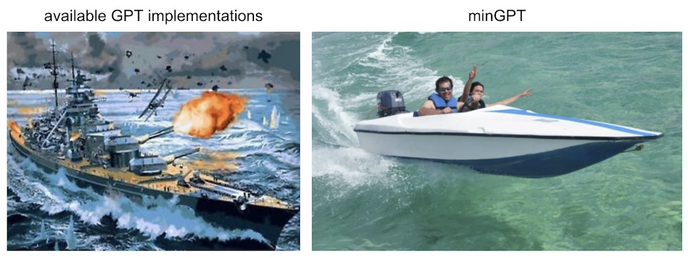

# minGPT

<p align="center">
  <a href="https://github.com/karpathy/minGPT/blob/master/README.md">English</a> · <b>简体中文</b>
</p>



[GPT](https://github.com/openai/gpt-2) 模型的 PyTorch 极简重实现，涵盖完整的训练与推理流程。目前市面上多数 GPT 模型实现往往相对臃肿庞杂，而 minGPT 致力于保持小巧、整洁、高度可解释且兼具教学启发性。GPT 本质上并不是一个复杂的模型，本项目模型核心实现仅约 300 行代码（参见 [mingpt/model.py](mingpt/model.py)）。其工作机制非常纯粹：将一系列 token 索引序列输入 [Transformer](https://arxiv.org/abs/1706.03762)，然后输出序列中下一个 token 索引的概率分布。绝大多数工程复杂度仅仅体现在为了追求计算效率，而在样本维度与序列长度维度上所采用的批处理（batching）技巧。

**说明（2023年1月）**：尽管可能会继续接收并调整部分代码细节，minGPT 当前整体处于半归档维护状态。如需关注最新进展，请参阅重写版项目 [nanoGPT](https://github.com/karpathy/nanoGPT)。简而言之，minGPT 已在大量 Notebook、技术博客、教学课程和专业图书中被广泛引用，这使得作者不太倾向于对代码库进行可能破坏向前兼容的大幅重构。同时作者也希望微调技术演进方向：从纯粹侧重教学，转向既保持极简易魔改、又具备实战性能的代码库（能够复现工业界中等规模基准测试、为了运行效率做出适度权衡等）。

minGPT 代码库仅由三个核心文件组成：[mingpt/model.py](mingpt/model.py) 包含完整的 Transformer 模型架构定义；[mingpt/bpe.py](mingpt/bpe.py) 包含一个轻量重构的字节对编码器（BPE 分词器），严格按照 OpenAI 在 GPT 中的方式实现文本与整数索引序列的双向转换；[mingpt/trainer.py](mingpt/trainer.py) 则是用于训练模型的 PyTorch 模版训练器代码（与 GPT 模型结构解耦）。此外，在 `projects` 目录下提供了一系列使用该库的演示项目：

- `projects/adder`：从零训练一个能够进行加法运算的 GPT 模型（灵感源自 GPT-3 论文中的加法测试章节）
- `projects/chargpt`：在指定输入文本文件上训练字符级（character-level）语言模型
- `demo.ipynb`：在简单数字排序任务上以 Notebook 形式展示 `GPT` 和 `Trainer` 的极简上手用法
- `generate.ipynb`：演示如何加载预训练 GPT-2 权重并根据输入提示词生成文本

### 库安装

如果希望在项目中直接 `import mingpt`：

```bash
git clone https://github.com/karpathy/minGPT.git
cd minGPT
pip install -e .
```

### 使用说明

实例化一个 GPT-2（1.24 亿参数量版本）：

```python
from mingpt.model import GPT
model_config = GPT.get_default_config()
model_config.model_type = 'gpt2'
model_config.vocab_size = 50257 # OpenAI 模型的词表大小
model_config.block_size = 1024  # OpenAI 模型的块大小（即输入上下文长度）
model = GPT(model_config)
```

模型训练方式：

```python
# 自定义继承自 torch.utils.data.Dataset 的数据集类
# 产出长度上限为 1024、整数取值范围为 [0, 50257) 的 torch LongTensor
train_dataset = YourDataset()

from mingpt.trainer import Trainer
train_config = Trainer.get_default_config()
train_config.learning_rate = 5e-4 # 包含多种可选超参数，详见源码文件
train_config.max_iters = 1000
train_config.batch_size = 32
trainer = Trainer(train_config, model, train_dataset)
trainer.run()
```

具体完整示例可参阅 `demo.ipynb`。

### 单元测试

测试覆盖率目前尚未达到完美状态，但可直接运行：

```bash
python -m unittest discover tests
```

### 待办清单 (TODOs)

- 添加在任意给定文本文件上的 GPT-2 微调（finetuning）示例
- 添加对话智能体（dialog agent）演示
- 为已有项目（adder、chargpt）补充更完善的结果与指标文档
- 增加混合精度训练（mixed precision）及相关规模化训练支持
- 增加分布式训练（distributed training）支持
- 在 `projects/` 中复现经典基准评测，例如 text8 或其他语言建模数据集
- 引入专业规范的日志记录机制，替代简陋的 print 打印语句
- 补充标准的 requirements.txt 依赖清单文件
- 支持加载除 gpt2-* 以外的更多外部模型权重

### 参考资料

代码实现参考：

- [openai/gpt-2](https://github.com/openai/gpt-2)：包含 TensorFlow 版模型定义，但未包含训练代码
- [openai/image-gpt](https://github.com/openai/image-gpt)：代码中包含若干更接近 GPT-3 现代风格的架构改动，是非常优质的参考代码
- [huggingface/transformers](https://github.com/huggingface/transformers)：包含[语言建模示例](https://github.com/huggingface/transformers/tree/master/examples/pytorch/language-modeling)。功能极其全面，但也因此较难单步追踪走读。例如部分大型函数中高达 90% 的分支代码在默认简单语言建模场景下完全处于闲置状态

学术论文与实现笔记：

#### 通过生成式预训练提升语言理解能力 (GPT-1)

- 模型基本遵循原始 Transformer 论文架构
- 训练了包含掩码自注意力头的 12 层仅解码器（decoder-only）Transformer（768 维隐层状态，12 个注意力头）。逐位置前馈网络采用 3072 维内部隐层
- Adam 优化器最大学习率为 2.5e-4（后续 GPT-3 在同等模型尺寸下使用 6e-4）
- 学习率衰减：前 2000 次更新内从 0 线性预热，随后按照余弦调度（cosine schedule）衰减至 0
- 在 64 个随机采样的 512 连续 token 序列的小批量（minibatch）上训练 100 个 epoch
- 由于在整个模型中广泛使用了 LayerNorm，简单的 N(0, 0.02) 权重正态初始化已足够
- 采用 40,000 次合并操作的字节对编码（BPE）词表
- 残差层、词嵌入层与注意力层均采用 0.1 的 Dropout 率进行正则化
- 采用文献 (37) 提出的修改版 L2 正则化，对所有非偏置和非增益权重设置 w = 0.01
- 激活函数采用高斯误差线性单元（GELU）
- 采用可学习的位置编码（learned position embeddings），替代原版论文提出的正弦位置编码
- 微调设置：为分类器添加 dropout 率为 0.1；学习率设为 6.25e-5，batch size 为 32；训练 3 个 epoch；采用线性学习率衰减，warmup 阶段占训练过程的 0.2%；λ 设为 0.5
- GPT-1 模型包含 12 层，d_model 为 768，约 1.17 亿参数量

#### 语言模型是无监督多任务学习者 (GPT-2)

- LayerNorm 被移至各个子模块的输入端，类似于预激活残差网络（pre-activation residual network）
- 在最终自注意力块之后增加了一个额外的 LayerNorm
- 采用修改版的权重初始化方案，考虑了随模型深度在残差路径上的累积效应。在初始化时将残差层权重按 1/√N 缩放（其中 N 为残差层总数）
- 词表扩充至 50,257
- 上下文长度从 512 扩展到 1024 个 token
- 采用更大的 512 batch size
- GPT-2 旗舰模型采用 48 层，d_model 为 1600（原始基准为 12 层、d_model 768），约 15.42 亿参数量

#### 语言模型是小样本学习者 (GPT-3)

- GPT-3 满血版：96 层，96 个注意力头，d_model 为 12,288（1750 亿参数）
- 类 GPT-1 尺寸对照版：12 层，12 个头，d_model 768（1.25 亿参数）
- 沿用与 GPT-2 相同的模型架构，包括上述修改版初始化、前置归一化（pre-normalization）与可逆分词机制
- 在 Transformer 各层中交替使用全连接密集注意力和局部带状稀疏注意力模式（similar to Sparse Transformer）
- 前馈网络的隐藏层维度始终保持为瓶颈层维度的 4 倍（dff = 4 * dmodel）
- 所有尺寸模型均采用 nctx = 2048 个 token 的上下文窗口
- Adam 优化器超参数设为 β1 = 0.9，β2 = 0.95，eps = 10^-8
- 所有模型均采用 0.1 的权重衰减以提供轻量正则化
- 将全局梯度范数（global norm）裁剪阈值设为 1.0
- 学习率在最初 3.75 亿 token 内进行线性预热；随后在接下来 2600 亿 token 训练过程中通过余弦退火衰减至初始值的 10%
- 在最初 40 亿至 120 亿 token 的训练中，batch size 从较小初值（32k tokens）逐步线性增加至满额设定
- 全程采用完整的 2048 长度上下文窗口，并使用特殊的文档结束符（END OF DOCUMENT）作为分隔标记

#### 基于像素的生成式预训练 (Image GPT)

- 在处理图像时采用标号排列 πi = i (1 <= i <= n)，即光栅扫描顺序（raster order）
- 通过使用 k = 512 的 k-means 算法对 (R, G, B) 像素值聚类，自制 9-bit 调色板
- 最大规格模型 iGPT-XL 包含 L = 60 层，embedding 维度 d = 3072，共计 68 亿参数
- 次大规格模型 iGPT-L 与 GPT-2 基本相同（L = 48 层），但 embedding 维度略小（d = 1536 vs 1600），共计 14 亿参数
- 采用与 GPT-2 相同的模型结构，但在初始化权重时依据分层方式进行调整，并将所有生成 logit 的投影矩阵零初始化
- 同时训练了 4.55 亿参数的 iGPT-M（L = 36, d = 1024）与 7600 万参数的 iGPT-S（L = 24, d = 512）
- 预训练 iGPT-XL 时采用 batch size 64 并训练 200 万次迭代；其余模型采用 batch size 128 并训练 100 万次迭代
- Adam 优化器参数 β1 = 0.9，β2 = 0.95
- 学习率预热 1 个 epoch，随后退火至 0
- 未使用权重衰减（weight decay），因评测显示应用 0.01 权重衰减并未改变特征表征质量
- iGPT-S 学习率设为 0.003
- 全程不使用 Dropout

### 开源许可证

MIT License

---

> **翻译说明（Translation Disclaimer）**
> 本文档由社区开发者维护，旨在降低中文开发者的阅读门槛。最后同步日期：2026年11月17日。若译文与英文原版存在任何出入或滞后，请以 [英文原版 (README.md)](https://github.com/karpathy/minGPT/blob/master/README.md) 为准。欢迎通过 PR 协助改进译文！
